# Hi, this is dataisland

Security researcher building agents and systems for vulnerability discovery, understanding, and repair.

Currently at [DepthFirst, AI. Inc](https://www.depthfirst.com/). PhD in Computer Science from [Northwestern University](https://www.northwestern.edu/).

[Home](https://www.dataisland.org/) · [X](https://x.com/dataisland99) · [LinkedIn](https://www.linkedin.com/in/zheng-yu-446b46250/)

<!-- contributions:start -->
## Contributions

<table width="100%">
<tr>
<td align="center" valign="top" width="120"><a href="https://github.com/torvalds/linux" title="Linux"> Linux</a></td>
<td align="center" valign="top" width="120"><a href="https://ubuntu.com/" title="Ubuntu"> Ubuntu</a></td>
<td align="center" valign="top" width="120"><a href="https://github.com/python/cpython" title="Python">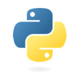 Python</a></td>
<td align="center" valign="top" width="120"><a href="https://github.com/google/angle" title="ANGLE"> ANGLE</a></td>
<td align="center" valign="top" width="120"><a href="https://github.com/microsoft/PyRIT" title="PyRIT"> PyRIT</a></td>
<td align="center" valign="top" width="120"><a href="https://www.oracle.com/database/" title="Oracle"> Oracle</a></td>
<td align="center" valign="top" width="120"><a href="https://www.mysql.com/" title="MySQL"> MySQL</a></td>
<td align="center" valign="top" width="120"><a href="https://github.com/FFmpeg/FFmpeg" title="FFmpeg"> FFmpeg</a></td>
</tr>
<tr>
<td align="center" valign="top" width="120"><a href="https://gitlab.com/gitlab-org/gitlab" title="GitLab (indirect contribution via Oj)"> GitLab</a></td>
<td align="center" valign="top" width="120"><a href="https://github.com/php/php-src" title="PHP"> PHP</a></td>
<td align="center" valign="top" width="120"><a href="https://github.com/postgres/postgres" title="PostgreSQL"> PostgreSQL</a></td>
<td align="center" valign="top" width="120"><a href="https://github.com/mongodb/bson-ruby" title="BSON Ruby"> BSON Ruby</a></td>
<td align="center" valign="top" width="120"><a href="https://github.com/rails/bootsnap" title="Bootsnap"> Bootsnap</a></td>
<td align="center" valign="top" width="120"><a href="https://github.com/getsentry/sentry-python" title="Sentry">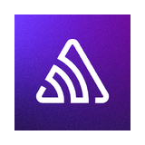 Sentry</a></td>
<td align="center" valign="top" width="120"><a href="https://github.com/protocolbuffers/protobuf" title="Protobuf"> Protobuf</a></td>
<td align="center" valign="top" width="120"><a href="https://github.com/GNUAspell/aspell" title="GNU Aspell"> GNU Aspell</a></td>
</tr>
<tr>
<td align="center" valign="top" width="120"><a href="https://github.com/openwrt/luci" title="OpenWrt LuCI"> OpenWrt LuCI</a></td>
<td align="center" valign="top" width="120"><a href="https://github.com/tile-ai/tilelang" title="TileLang — DeepSeek ecosystem association"> TileLang</a></td>
<td align="center" valign="top" width="120"><a href="https://github.com/curl/curl" title="curl">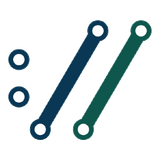 curl</a></td>
<td align="center" valign="top" width="120"><a href="https://github.com/jqlang/jq" title="jq"> jq</a></td>
<td align="center" valign="top" width="120"><a href="https://github.com/bytecodealliance/wasmtime" title="Wasmtime">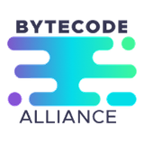 Wasmtime</a></td>
<td align="center" valign="top" width="120"><a href="https://github.com/mlc-ai/xgrammar" title="XGrammar"> XGrammar</a></td>
<td align="center" valign="top" width="120"><a href="https://github.com/puma/puma" title="Puma"> Puma</a></td>
<td align="center" valign="top" width="120"><a href="https://github.com/sparklemotion/nokogiri" title="Nokogiri"> Nokogiri</a></td>
</tr>
<tr>
<td align="center" valign="top" width="120"><a href="https://github.com/ruby/json" title="Ruby JSON">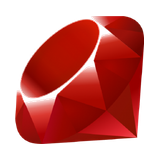 Ruby JSON</a></td>
<td align="center" valign="top" width="120"><a href="https://github.com/sparklemotion/sqlite3-ruby" title="sqlite3-ruby"> sqlite3-ruby</a></td>
<td align="center" valign="top" width="120"><a href="https://github.com/HDFGroup/hdf5" title="HDF5"> HDF5</a></td>
<td align="center" valign="top" width="120"><a href="https://github.com/PointCloudLibrary/pcl" title="PCL">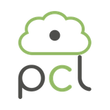 PCL</a></td>
<td align="center" valign="top" width="120"><a href="https://github.com/assimp/assimp" title="Assimp — Adobe is a financial supporter">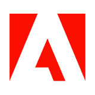 Assimp</a></td>
<td align="center" valign="top" width="120"><a href="https://libtiff.gitlab.io/libtiff/" title="LibTIFF"> LibTIFF</a></td>
<td align="center" valign="top" width="120"><a href="https://github.com/libjpeg-turbo/libjpeg-turbo" title="libjpeg-turbo">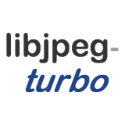 libjpeg-turbo</a></td>
<td align="center" valign="top" width="120"><a href="https://github.com/gpac/gpac" title="GPAC"> GPAC</a></td>
</tr>
<tr>
<td align="center" valign="top" width="120"><a href="https://github.com/bluez/bluez" title="BlueZ"> BlueZ</a></td>
<td align="center" valign="top" width="120"><a href="https://github.com/libssh2/libssh2" title="libssh2"> libssh2</a></td>
<td align="center" valign="top" width="120"><a href="https://github.com/angr/angr" title="angr"> angr</a></td>
<td align="center" valign="top" width="120"><a href="https://github.com/qilingframework/qiling" title="Qiling">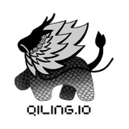 Qiling</a></td>
<td align="center" valign="top" width="120"><a href="https://github.com/unicorn-engine/unicorn" title="Unicorn"> Unicorn</a></td>
<td align="center" valign="top" width="120"><a href="https://github.com/wasm3/wasm3" title="Wasm3">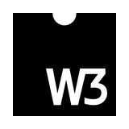 Wasm3</a></td>
<td align="center" valign="top" width="120"><a href="https://github.com/finos/git-proxy" title="GitProxy — FINOS / Linux Foundation"> GitProxy</a></td>
<td align="center" valign="top" width="120"><a href="https://github.com/open62541/open62541" title="open62541">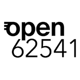 open62541</a></td>
</tr>
<tr>
<td align="center" valign="top" width="120"><a href="https://github.com/seladb/PcapPlusPlus" title="PcapPlusPlus"> PcapPlusPlus</a></td>
<td align="center" valign="top" width="120"><a href="https://github.com/ntop/ntopng" title="ntopng"> ntopng</a></td>
<td align="center" valign="top" width="120"><a href="https://github.com/ged/ruby-pg" title="ruby-pg"> ruby-pg</a></td>
<td align="center" valign="top" width="120"><a href="https://github.com/rmagick/rmagick" title="RMagick">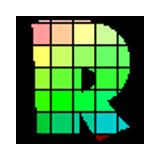 RMagick</a></td>
<td align="center" valign="top" width="120"><a href="https://github.com/ohler55/oj" title="Oj"> Oj</a></td>
<td align="center" valign="top" width="120"><a href="https://github.com/hunspell/hunspell" title="Hunspell — supported by FSF.hu"> Hunspell</a></td>
<td align="center" valign="top" width="120"><a href="https://github.com/Blosc/c-blosc2" title="C-Blosc2"> C-Blosc2</a></td>
<td align="center" valign="top" width="120"><a href="https://github.com/LibreDWG/libredwg" title="LibreDWG"> LibreDWG</a></td>
</tr>
<tr>
<td align="center" valign="top" width="120"><a href="https://github.com/free5gc/gtp5g" title="free5GC gtp5g"> free5GC gtp5g</a></td>
<td align="center" valign="top" width="120"><a href="https://github.com/ctf-wiki/ctf-wiki" title="CTF Wiki">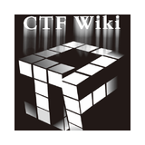 CTF Wiki</a></td>
<td align="center" valign="top" width="120"><a href="https://github.com/hercules-team/augeas" title="Augeas">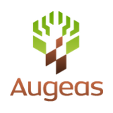 Augeas</a></td>
<td align="center" valign="top" width="120"><a href="https://github.com/cesanta/mjs" title="mJS"> mJS</a></td>
<td align="center" valign="top" width="120"><a href="https://github.com/yasm/yasm" title="Yasm"> Yasm</a></td>
</tr>
</table>
<!-- contributions:end -->
