# Hi, this is dataisland

Security researcher building agents and systems for vulnerability discovery, understanding, and repair.

Currently at [DepthFirst, AI. Inc](https://www.depthfirst.com/). PhD in Computer Science from [Northwestern University](https://www.northwestern.edu/).

[Home](https://www.dataisland.org/) · [X](https://x.com/dataisland99) · [LinkedIn](https://www.linkedin.com/in/zheng-yu-446b46250/)

<!-- contributions:start -->
## Open-source contributions

<table>
<tr>
<td align="center" valign="middle" width="110"><a href="CONTRIBUTION.md#angle"> ANGLE</a></td>
<td align="center" valign="middle" width="110"><a href="CONTRIBUTION.md#angr"> angr</a></td>
<td align="center" valign="middle" width="110"><a href="CONTRIBUTION.md#assimp">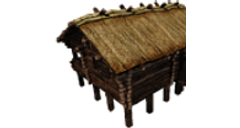 Assimp</a></td>
<td align="center" valign="middle" width="110"><a href="CONTRIBUTION.md#augeas"> Augeas</a></td>
<td align="center" valign="middle" width="110"><a href="CONTRIBUTION.md#bluez"> BlueZ</a></td>
<td align="center" valign="middle" width="110"><a href="CONTRIBUTION.md#bootsnap">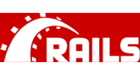 Bootsnap</a></td>
</tr>
<tr>
<td align="center" valign="middle" width="110"><a href="CONTRIBUTION.md#bson-ruby"> BSON Ruby</a></td>
<td align="center" valign="middle" width="110"><a href="CONTRIBUTION.md#c-blosc2"> C-Blosc2</a></td>
<td align="center" valign="middle" width="110"><a href="CONTRIBUTION.md#ctf-wiki">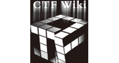 CTF Wiki</a></td>
<td align="center" valign="middle" width="110"><a href="CONTRIBUTION.md#curl"> curl</a></td>
<td align="center" valign="middle" width="110"><a href="CONTRIBUTION.md#ffmpeg"> FFmpeg</a></td>
<td align="center" valign="middle" width="110"><a href="CONTRIBUTION.md#free5gc-gtp5g"> free5GC gtp5g</a></td>
</tr>
<tr>
<td align="center" valign="middle" width="110"><a href="CONTRIBUTION.md#gitproxy"> GitProxy</a></td>
<td align="center" valign="middle" width="110"><a href="CONTRIBUTION.md#gnu-aspell">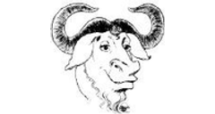 GNU Aspell</a></td>
<td align="center" valign="middle" width="110"><a href="CONTRIBUTION.md#gpac"> GPAC</a></td>
<td align="center" valign="middle" width="110"><a href="CONTRIBUTION.md#hdf5"> HDF5</a></td>
<td align="center" valign="middle" width="110"><a href="CONTRIBUTION.md#hunspell"> Hunspell</a></td>
<td align="center" valign="middle" width="110"><a href="CONTRIBUTION.md#jq"> jq</a></td>
</tr>
<tr>
<td align="center" valign="middle" width="110"><a href="CONTRIBUTION.md#libjpeg-turbo">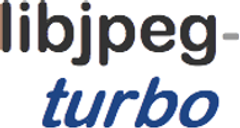 libjpeg-turbo</a></td>
<td align="center" valign="middle" width="110"><a href="CONTRIBUTION.md#libredwg">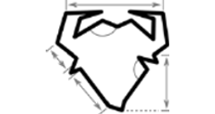 LibreDWG</a></td>
<td align="center" valign="middle" width="110"><a href="CONTRIBUTION.md#libssh2">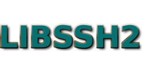 libssh2</a></td>
<td align="center" valign="middle" width="110"><a href="CONTRIBUTION.md#libtiff">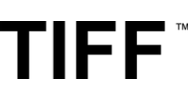 LibTIFF</a></td>
<td align="center" valign="middle" width="110"><a href="CONTRIBUTION.md#linux"> Linux</a></td>
<td align="center" valign="middle" width="110"><a href="CONTRIBUTION.md#mjs"> mJS</a></td>
</tr>
<tr>
<td align="center" valign="middle" width="110"><a href="CONTRIBUTION.md#nokogiri"> Nokogiri</a></td>
<td align="center" valign="middle" width="110"><a href="CONTRIBUTION.md#ntopng"> ntopng</a></td>
<td align="center" valign="middle" width="110"><a href="CONTRIBUTION.md#oj"> Oj</a></td>
<td align="center" valign="middle" width="110"><a href="CONTRIBUTION.md#open62541"> open62541</a></td>
<td align="center" valign="middle" width="110"><a href="CONTRIBUTION.md#openwrt-luci"> OpenWrt LuCI</a></td>
<td align="center" valign="middle" width="110"><a href="CONTRIBUTION.md#pcapplusplus">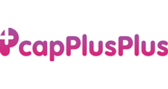 PcapPlusPlus</a></td>
</tr>
<tr>
<td align="center" valign="middle" width="110"><a href="CONTRIBUTION.md#pcl"> PCL</a></td>
<td align="center" valign="middle" width="110"><a href="CONTRIBUTION.md#php"> PHP</a></td>
<td align="center" valign="middle" width="110"><a href="CONTRIBUTION.md#postgresql"> PostgreSQL</a></td>
<td align="center" valign="middle" width="110"><a href="CONTRIBUTION.md#protobuf">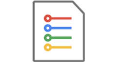 Protobuf</a></td>
<td align="center" valign="middle" width="110"><a href="CONTRIBUTION.md#pyrit"> PyRIT</a></td>
<td align="center" valign="middle" width="110"><a href="CONTRIBUTION.md#python"> Python</a></td>
</tr>
<tr>
<td align="center" valign="middle" width="110"><a href="CONTRIBUTION.md#qiling">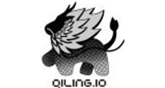 Qiling</a></td>
<td align="center" valign="middle" width="110"><a href="CONTRIBUTION.md#rmagick">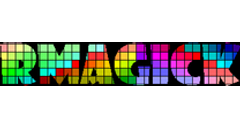 RMagick</a></td>
<td align="center" valign="middle" width="110"><a href="CONTRIBUTION.md#ruby-json">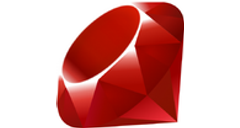 Ruby JSON</a></td>
<td align="center" valign="middle" width="110"><a href="CONTRIBUTION.md#sentry"> Sentry</a></td>
<td align="center" valign="middle" width="110"><a href="CONTRIBUTION.md#shivyc"> ShivyC</a></td>
<td align="center" valign="middle" width="110"><a href="CONTRIBUTION.md#sqlite3-ruby"> sqlite3-ruby</a></td>
</tr>
<tr>
<td align="center" valign="middle" width="110"><a href="CONTRIBUTION.md#tilelang"> TileLang</a></td>
<td align="center" valign="middle" width="110"><a href="CONTRIBUTION.md#unicorn"> Unicorn</a></td>
<td align="center" valign="middle" width="110"><a href="CONTRIBUTION.md#wasm3">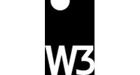 Wasm3</a></td>
<td align="center" valign="middle" width="110"><a href="CONTRIBUTION.md#wasmtime">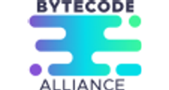 Wasmtime</a></td>
<td align="center" valign="middle" width="110"><a href="CONTRIBUTION.md#xgrammar">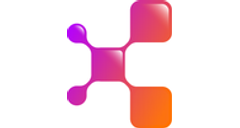 XGrammar</a></td>
<td align="center" valign="middle" width="110"><a href="CONTRIBUTION.md#yasm"> Yasm</a></td>
</tr>
</table>
<!-- contributions:end -->
