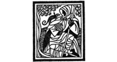

# Hi, this is dataisland

Security researcher building agents and systems for vulnerability discovery, understanding, and repair.

Currently at [DepthFirst, AI. Inc](https://www.depthfirst.com/). PhD in Computer Science from [Northwestern University](https://www.northwestern.edu/).

[Home](https://www.dataisland.org/) · [X](https://x.com/dataisland99) · [LinkedIn](https://www.linkedin.com/in/zheng-yu-446b46250/)

<!-- contributions:start -->
## Contributions

<table width="100%">
<tr>
<td align="center" valign="middle" width="12.5%"></td>
<td align="center" valign="middle" width="12.5%"></td>
<td align="center" valign="middle" width="12.5%"></td>
<td align="center" valign="middle" width="12.5%"></td>
<td align="center" valign="middle" width="12.5%"></td>
<td align="center" valign="middle" width="12.5%"></td>
<td align="center" valign="middle" width="12.5%"></td>
<td align="center" valign="middle" width="12.5%"></td>
</tr>
<tr>
<td align="center" valign="middle" width="12.5%"></td>
<td align="center" valign="middle" width="12.5%"></td>
<td align="center" valign="middle" width="12.5%"></td>
<td align="center" valign="middle" width="12.5%"></td>
<td align="center" valign="middle" width="12.5%"></td>
<td align="center" valign="middle" width="12.5%"></td>
<td align="center" valign="middle" width="12.5%"></td>
<td align="center" valign="middle" width="12.5%"></td>
</tr>
<tr>
<td align="center" valign="middle" width="12.5%"></td>
<td align="center" valign="middle" width="12.5%"></td>
<td align="center" valign="middle" width="12.5%"></td>
<td align="center" valign="middle" width="12.5%"></td>
<td align="center" valign="middle" width="12.5%"></td>
<td align="center" valign="middle" width="12.5%"></td>
<td align="center" valign="middle" width="12.5%"></td>
<td align="center" valign="middle" width="12.5%"></td>
</tr>
<tr>
<td align="center" valign="middle" width="12.5%"></td>
<td align="center" valign="middle" width="12.5%"></td>
<td align="center" valign="middle" width="12.5%"></td>
<td align="center" valign="middle" width="12.5%"></td>
<td align="center" valign="middle" width="12.5%"></td>
<td align="center" valign="middle" width="12.5%"></td>
<td align="center" valign="middle" width="12.5%"></td>
<td align="center" valign="middle" width="12.5%"></td>
</tr>
<tr>
<td align="center" valign="middle" width="12.5%"></td>
<td align="center" valign="middle" width="12.5%"></td>
<td align="center" valign="middle" width="12.5%"></td>
<td align="center" valign="middle" width="12.5%"></td>
<td align="center" valign="middle" width="12.5%"></td>
<td align="center" valign="middle" width="12.5%"></td>
<td align="center" valign="middle" width="12.5%"></td>
<td align="center" valign="middle" width="12.5%"></td>
</tr>
<tr>
<td align="center" valign="middle" width="12.5%"></td>
<td align="center" valign="middle" width="12.5%"></td>
<td align="center" valign="middle" width="12.5%"></td>
<td align="center" valign="middle" width="12.5%"></td>
<td align="center" valign="middle" width="12.5%"></td>
<td align="center" valign="middle" width="12.5%"></td>
<td align="center" valign="middle" width="12.5%"></td>
<td align="center" valign="middle" width="12.5%"></td>
</tr>
<tr>
<td align="center" valign="middle" width="12.5%"></td>
<td align="center" valign="middle" width="12.5%"></td>
<td align="center" valign="middle" width="12.5%"></td>
</tr>
</table>
<!-- contributions:end -->
